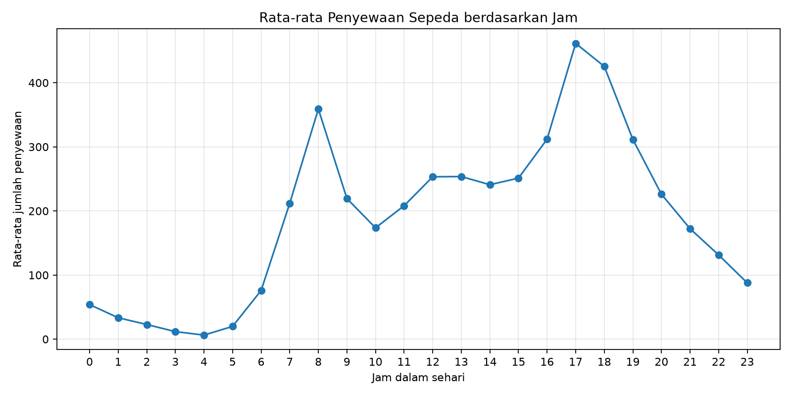
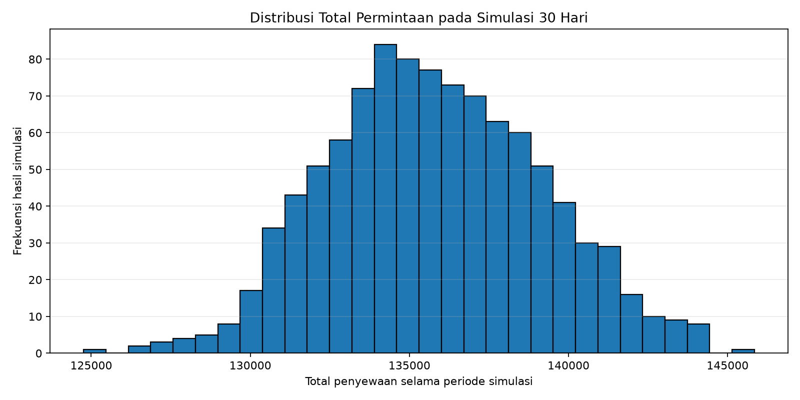

# Simulasi Monte Carlo Permintaan Penyewaan Sepeda

## 1. Deskripsi proyek

Proyek ini menerapkan pemodelan dan simulasi untuk memperkirakan variasi total permintaan penyewaan sepeda selama periode 30 hari berdasarkan pola permintaan historis per jam. Metode yang digunakan adalah **Monte Carlo berbasis empirical bootstrap**: nilai historis untuk setiap jam dipilih secara acak dengan pengembalian, lalu dijumlahkan menjadi satu periode simulasi.

Proyek ini tidak bertujuan memprediksi angka permintaan secara pasti dan tidak membuktikan hubungan sebab-akibat. Hasilnya menunjukkan rentang kemungkinan total permintaan jika pola historis per jam berulang.

## 2. Pertanyaan proyek

- Bagaimana rata-rata jumlah penyewaan berubah dari jam ke jam?
- Berapa perkiraan total penyewaan untuk periode simulasi 30 hari?
- Seberapa lebar variasi hasil total permintaan berdasarkan simulasi berulang?

## 3. Sumber data

**UCI Machine Learning Repository — Bike Sharing Dataset**

- Halaman dataset: https://archive.ics.uci.edu/dataset/275/bike%2Bsharing%2Bdataset
- Pembuat dataset: Hadi Fanaee-T
- Data mencakup catatan penyewaan per jam dan harian untuk Capital Bikeshare pada 2011–2012, beserta informasi waktu, musim, dan cuaca.
- File yang digunakan: `hour.csv`
- Kolom utama: `hr` (jam 0–23) dan `cnt` (jumlah total penyewaan pada jam tersebut).
- Lisensi dataset: CC BY 4.0. Cantumkan atribusi sumber jika membagikan atau mengadaptasi data.

Sitasi:
Fanaee-T, H. (2013). *Bike Sharing* [Dataset]. UCI Machine Learning Repository. https://doi.org/10.24432/C5W894

## 4. Bahasa dan pustaka

- **Bahasa pemrograman:** Python
- **NumPy:** pengambilan sampel acak dan perhitungan numerik
- **pandas:** membaca CSV dan meringkas data
- **Matplotlib:** membuat grafik

## 5. Model dan asumsi

Misalkan `D(h)` adalah kumpulan nilai penyewaan historis pada jam `h`.

Untuk satu simulasi 30 hari, program mengambil 30 sampel dari kumpulan historis masing-masing jam, dengan pengembalian. Total periode simulasi adalah:

`T = jumlah seluruh sampel untuk jam 0 sampai 23 selama 30 hari`

Proses diulang 1.000 kali dengan seed acak tetap (`42`) agar hasil dapat direproduksi.

Asumsi utama:
1. Pola historis penyewaan pada jam yang sama cukup representatif untuk simulasi.
2. Sampel historis dipilih dengan pengembalian.
3. Hubungan antarjam, hari kerja/libur, musim, dan cuaca tidak dimodelkan secara bersama. Karena itu, hasil adalah model sederhana untuk eksplorasi, bukan prediksi operasional yang pasti.

## 6. Cara menjalankan

1. Unduh dataset dari halaman UCI di atas.
2. Ekstrak berkas ZIP.
3. Salin `hour.csv` ke `data/raw/hour.csv` di dalam proyek ini.
4. Pastikan Python sudah terpasang.
5. Buka terminal di folder proyek, lalu jalankan:

```bash
python -m pip install -r requirements.txt
python main.py
```

## 7. Output dan Hasil Simulasi

Program telah berhasil dijalankan pada 17.379 baris data historis dengan 1.000 iterasi simulasi untuk periode 30 hari (seed acak `42`).

### Ringkasan Statistik Simulasi

| Metrik | Nilai |
|---|---:|
| **Jumlah Simulasi** | 1.000 iterasi |
| **Durasi per Simulasi** | 30 hari |
| **Rata-rata Total Permintaan** | 135.815,20 penyewaan |
| **Median Total Permintaan** | 135.653,50 penyewaan |
| **Persentil ke-5** | 130.630,50 penyewaan |
| **Persentil ke-95** | 141.332,00 penyewaan |
| **Simpangan Baku (Std Dev)** | 3.365,40 penyewaan |

### Visualisasi Hasil

1. **Pola Permintaan per Jam:**
   Puncak permintaan tertinggi terjadi pada jam pulang kantor (**pukul 17:00** dengan rata-rata 461,45 penyewaan dan **pukul 18:00** dengan 425,51 penyewaan), serta jam berangkat kerja (**pukul 08:00** dengan 359,01 penyewaan). Titik terendah berada pada dini hari (**pukul 04:00** dengan rata-rata 6,35 penyewaan).

   

2. **Distribusi Total Simulasi:**
   Histogram total permintaan menunjukkan kurva distribusi normal yang simetris, di mana 90% hasil simulasi berkisar antara 130.630 hingga 141.332 penyewaan.

   

## 8. Berkas Output

Seluruh berkas keluaran program tersimpan di folder `results/`:
- `results/ringkasan_per_jam.csv` — statistik deskriptif per jam (jumlah data, rata-rata, median, simpangan baku).
- `results/rata_rata_per_jam.png` — visualisasi grafik garis rata-rata per jam.
- `results/hasil_simulasi.csv` — catatan total permintaan pada setiap iterasi dari 1.000 simulasi.
- `results/ringkasan_simulasi.json` — rangkuman indikator utama simulasi.
- `results/distribusi_total_simulasi.png` — visualisasi histogram distribusi simulasi.

## 9. Struktur repositori

```text
bike-sharing-simulation/
├── data/
│   └── raw/
│       └── hour.csv             # dataset Bike Sharing dari UCI (17.379 baris)
├── results/                     # output simulasi (CSV, JSON, grafik PNG)
│   ├── distribusi_total_simulasi.png
│   ├── hasil_simulasi.csv
│   ├── rata_rata_per_jam.png
│   ├── ringkasan_per_jam.csv
│   └── ringkasan_simulasi.json
├── main.py                      # skrip utama pemodelan dan simulasi Monte Carlo
├── requirements.txt             # dependensi pustaka Python
├── REPORT_TEMPLATE.md           # draf laporan lengkap analisis dan interpretasi
├── AI_USAGE.md                  # transparansi penggunaan AI dan log aktivitas
└── README.md                    # dokumentasi utama repositori
```

## 10. Catatan Keterlibatan AI

Proyek ini mendokumentasikan keterlibatan AI secara transparan. Rincian peran AI, log aktivitas mahasiswa, dan pernyataan kepatuhan akademik dapat dilihat pada [AI_USAGE.md](AI_USAGE.md).
